

  

  

<h3 align="center">Machine Learning &amp; AI Engineering · Python Development</h3>

  
  
  
  

  

## About Me

I'm a **BS Software Engineering** student who builds ML and AI systems **end-to-end** — from data collection and preprocessing through model training, evaluation, and deployment. My focus areas are **Machine Learning, Deep Learning, and Generative AI**, with a particular interest in computer vision, LLM-powered applications, and production-style workflows.

I care about **shipped artifacts over tutorials**: custom datasets trained from scratch, deterministic systems that keep models safe, and reproducible, well-tested code.

<table>
<tr>
<td width="25%" align="center"><b>Focus</b> ML · DL · GenAI · Computer Vision · Data Science</td>
<td width="25%" align="center"><b>Building with</b> Python · TensorFlow / Keras · Scikit-learn · OpenCV</td>
<td width="25%" align="center"><b>Exploring</b> RAG · LangChain · MLOps · AWS</td>
<td width="25%" align="center"><b>Open to</b> ML / AI internships · junior roles</td>
</tr>
</table>

  

## Featured Projects

<table>
<tr>
<td width="50%" valign="top">

<code>Python</code> <code>Streamlit</code> <code>LLM APIs</code> <code>Pydantic</code> <code>pytest</code>

Five stateful agents negotiate over a scarce resource pool behind a <b>deterministic validator</b> that no model can override. Ships with a live Mission Control dashboard, honest LLM fallback handling, and a <b>passing automated test suite</b>.

<a href="https://github.com/zohaakhawajaa/ares-mars-accord">View repository →</a>
</td>
<td width="50%" valign="top">

<code>Python</code> <code>YOLOv8</code> <code>OpenCV</code> <code>Roboflow</code>

Built a <b>custom dataset from scratch</b> with two annotated classes, then trained a full pipeline: data collection → annotation → training → testing, with demo videos of detection in practical scenarios.

<a href="https://github.com/zohaakhawajaa/Helmet-Number-Plate-Detection-using-YOLOv8">View repository →</a>
</td>
</tr>
<tr>
<td width="50%" valign="top">

<code>Scikit-learn</code> <code>XGBoost</code> <code>TensorFlow</code> <code>Keras</code>

Compares Logistic Regression, Decision Tree, Random Forest, XGBoost, and a fully connected neural network — with hyperparameter tuning, ROC-AUC / F1 evaluation, and a Kaggle submission.

<a href="https://github.com/zohaakhawajaa/bank-customer-churn-ml-dl">View repository →</a>
</td>
<td width="50%" valign="top">

<code>Python</code> <code>Scikit-learn</code> <code>Pandas</code> <code>Seaborn</code>

Complete ML workflow — EDA, missing-value imputation, outlier handling, feature encoding, training and evaluation — with an explicit educational-use disclaimer.

<a href="https://github.com/zohaakhawajaa/heart-disease-prediction-ml">View repository →</a>
</td>
</tr>
<tr>
<td width="50%" valign="top">

<code>TensorFlow</code> <code>Keras</code> <code>Scikit-learn</code> <code>Prophet</code> <code>NLP</code>

Covers classical ML, CNN / RNN / LSTM / GRU, <b>transfer learning with MobileNetV2</b> (including TensorFlow Lite export), NLP, and <b>time-series forecasting</b> with Prophet and ARIMA / SARIMA.

<a href="https://github.com/zohaakhawajaa/machine-learning-deep-learning">View repository →</a>
</td>
<td width="50%" valign="top">

<code>Pandas</code> <code>NumPy</code> <code>Matplotlib</code> <code>Seaborn</code>

Python EDA on video game sales — data cleaning, statistical analysis and visual insights — plus supporting tasks in bank churn and diabetes prediction.

<a href="https://github.com/zohaakhawajaa/devixo-solutions-ai-ml-internship">View repository →</a>
</td>
</tr>
</table>

  

## Tech Stack

  

 

<table>
<tr>
<td width="50%" valign="top">
<b>Languages &amp; Data</b> 
<code>Python</code> <code>SQL</code> <code>Pandas</code> <code>NumPy</code>
</td>
<td width="50%" valign="top">
<b>Machine Learning &amp; Deep Learning</b> 
<code>Scikit-learn</code> <code>TensorFlow</code> <code>Keras</code> <code>XGBoost</code> <code>PyTorch</code>
</td>
</tr>
<tr>
<td width="50%" valign="top">
<b>Data Visualization &amp; Analysis</b> 
<code>Matplotlib</code> <code>Seaborn</code> <code>Plotly</code> <code>ydata-profiling</code>
</td>
<td width="50%" valign="top">
<b>Computer Vision</b> 
<code>OpenCV</code> <code>YOLOv8</code> <code>Ultralytics</code> <code>Roboflow</code>
</td>
</tr>
<tr>
<td width="50%" valign="top">
<b>Generative AI &amp; LLMs</b> (building &amp; exploring) 
<code>LLM APIs</code> <code>LangChain</code> <code>RAG</code> <code>Embeddings</code>
</td>
<td width="50%" valign="top">
<b>Tools &amp; Deployment</b> 
<code>Git</code> <code>GitHub</code> <code>Jupyter</code> <code>Colab</code> <code>Streamlit</code> <code>FastAPI</code> <code>pytest</code> <code>AWS</code>
</td>
</tr>
</table>

  

## GitHub Analytics

  
  

  

  

<!--
## Contribution Snake

Uncomment this block after the "Generate Snake" workflow has run at least once
(see `.github/workflows/snake.yml`). The image is published to the `output` branch.

  

-->

  

## Connect

  I'm actively looking for <b>Machine Learning / AI internships and junior roles</b>. The fastest way to reach me:

<table align="center">
<tr>
<td> &nbsp;<a href="https://www.linkedin.com/in/zoha-khawaja-99671831b/">zoha-khawaja</a></td>
<td> &nbsp;<a href="mailto:zohaakhawajaa@gmail.com">zohaakhawajaa@gmail.com</a></td>
</tr>
<tr>
<td> &nbsp;<a href="https://zoha-portfolio-mi6c.vercel.app/">Live portfolio site</a></td>
<td> &nbsp;<a href="https://www.kaggle.com/zohakhawaja">zohakhawaja</a></td>
</tr>
</table>

  

